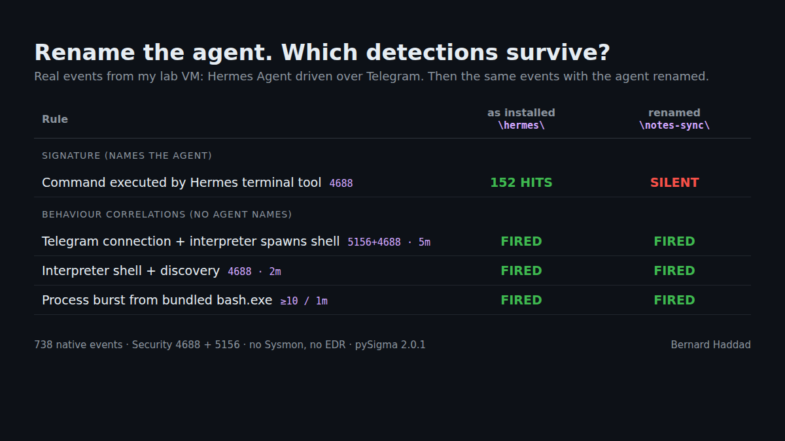

# ai-agent-hunting

Lab notes from looking at AI agents the way we already look at RMM tools: trusted
software, already on the box, doing exactly what it was built to do, for whoever is
giving the instructions.

Two parts:

- Claude Code / Claude Desktop: what it leaves on disk and what its child processes carry
  in their environment.
- Hermes Agent (Nous Research, v0.21.7) set up the way an attacker with a foothold would:
  driven from Telegram, approvals off, persistent. What that looks like with plain
  Windows logging (no Sysmon, no EDR), and what's left behind afterwards.

Then the detections, and the tests I used to check them.

None of this is a vulnerability. Everything here is a documented feature being used by
the wrong person.

One VM (FlareVM on Windows 11), the versions named below. Things I marked as *observed*
aren't documented and can change in any release, so re-test before you rely on them.



---

## Claude Code / Claude Desktop

### Environment of a spawned shell

Claude Desktop 2.31226.1. I opened a shell from the Code tab and looked at its environment
in Process Explorer (Properties > Environment):

| Variable | Value | |
|---|---|---|
| `CLAUDECODE` | `1` | documented |
| `CLAUDE_CODE_CHILD_SESSION` | `1` | documented |
| `CLAUDE_CODE_SESSION_ID` | session id | documented |
| `CLAUDE_CODE_ENTRYPOINT` | `claude-desktop` | observed |
| `CLAUDE_CODE_USER_EMAIL` | my email | observed |
| `CLAUDE_CODE_ORGANIZATION_UUID` | org uuid | observed |
| `CLAUDE_CODE_OAUTH_SCOPES` | `user:inference user:file_upload user:profile user:sessions:claude_code user:plugins` | observed |
| `CLAUDE_CODE_EXECPATH` | `...\AppData\Local\Packages\Claude_pzs8sxrjxfjjc\LocalCache\Roaming\Claude\claude-code\2.1.x\...` | observed |

So anything the agent starts carries the signed-in account. Useful for attribution if you
capture process environment. Less nice when you remember a prompt-injected command gets
the same values.

Also note the path. Desktop is an MSIX package, so its files really live under
`AppData\Local\Packages\Claude_pzs8sxrjxfjjc\LocalCache\Roaming\Claude\` and not
`%APPDATA%\Claude`. If you only image the obvious path you miss them.

### Files worth grabbing

From the [.claude directory docs](https://code.claude.com/docs/en/claude-directory):

- `~/.claude/projects/<project>/<session>.jsonl` - full transcript, every tool call and its
  output, plaintext
- `~/.claude/history.jsonl` - every prompt with timestamp and project path
- `~/.claude/file-history/<session>/` - copies of files before Claude edited them
- terminal sessions are cleaned up after 30 days by default (`cleanupPeriodDays`), Desktop
  and Cowork ones are kept unless `desktopSessionCleanupPeriodDays` is set

From the [managed settings docs](https://code.claude.com/docs/en/managed-settings): if there's
no admin policy, Claude Code reads `HKCU\SOFTWARE\Policies\ClaudeCode`, and the docs say a
user can write to it. Not privilege escalation, just one more place config can be planted
on an unmanaged machine.

---

## Hermes Agent as a Telegram RAT

### Why Hermes

Hermes can be driven from Telegram, Discord, Slack, WhatsApp or Signal, runs shell
commands, schedules its own jobs and writes its own skills. It's already abused: the
Carbonato botnet drops it on exposed Docker hosts and drives it over Telegram
([The Hacker News, 28 Sep 2026](https://thehackernews.com/2026/09/carbonato-botnet-compromises-docker.html)).
The detection guidance I found ([DTEX](https://www.dtex.ai/resources/i%C2%B3-threat-advisory-hermes-ai-agent-detection/))
doesn't cover the Windows side, so that's what I looked at.

Scenario: attacker already has a foothold, installs the real Hermes, points it at their
own bot, turns approvals off, makes it persistent.

### Timeline (UTC+3)

```
07:45:49  elevated PowerShell: schtasks /create /tn OneDriveSync /tr "powershell -NoProfile
          -ExecutionPolicy Bypass -WindowStyle Hidden -File C:\Users\Public\stage.ps1"   [4688]
07:45:54  task runs hidden powershell stage.ps1 -> official installer                    [4688]
08:32:22  Defender exclusion for the whole ...\AppData\Local\hermes                      [5007]
~11:40    approvals.mode set to off (unquoted `off` is YAML false, had to quote it)
12:14:13  gateway connects to Telegram, registers 60 bot commands          [gateway.log]
12:17     Hermes pip-installs Telegram support into its own Python                  [4688]
12:23     hostname, whoami, ipconfig /all, "list my Documents" sent from Telegram
12:50:11  "run tasklist every hour and send me the output" -> cron job  [cron\jobs.json]
13:52     job runs unattended, again 14:54, last_status ok
15:20:06  sign out / sign in: explorer > wscript > wscript > python ... gateway run  [4688]
```

### What I found

**Persistence is two hidden VBScript stages.** No scheduled task got registered, so
`hermes gateway install` used its [documented Startup-folder fallback](https://hermes-agent.nousresearch.com/docs/user-guide/windows-native):

```
explorer.exe
 └─ wscript.exe "...\Start Menu\Programs\Startup\Hermes_Gateway.vbs"
     └─ wscript.exe ...\AppData\Local\hermes\gateway-service\Hermes_Gateway.vbs
         └─ ...\hermes\tools\python-3.14.7+...\python.exe -m hermes_cli.main gateway run   (hidden)
```

Without context that's indistinguishable from a malware loader.

**Commands run through Hermes' own Git Bash, so the binary names lie.** The gateway's
python starts `...\hermes\tools\git-2.53.0+3-win32-x64\usr\bin\bash.exe`, and `whoami` /
`hostname` resolve to the Git copies in `usr\bin`, not System32. `ipconfig` has no Git
version so that one came from System32.

```
Parent : ...\hermes\tools\git-2.53.0+3-win32-x64\usr\bin\bash.exe
Process: ...\hermes\tools\git-2.53.0+3-win32-x64\usr\bin\whoami.exe
```

A rule on the System32 path, Microsoft signer or OriginalFileName won't fire. Each chat
message also produced a burst of roughly 10-40 processes under that bash.exe.

**It enumerates every process, all the time.** The Hermes python kept running
`powershell -NoProfile -Command "Get-CimInstance Win32_Process | ForEach-Object {...}"`,
often seconds apart, plus `cmd /c ver` at gateway start. Looks exactly like discovery
(T1057/T1082) and will be noisy wherever Hermes is legitimately installed.

**Output goes to two places.** Telegram (149.154.166.110) and the LLM provider, OpenRouter
in my case (104.18.3.115), because the model reads the output to write the reply.

**state.db has the whole story.** `%LOCALAPPDATA%\hermes\state.db`, SQLite in WAL mode, so
copy `-wal` and `-shm` with it. 25 tables, these are the ones I used:

- `sessions` - `source` (cli / telegram / cron), `user_id`, `chat_id`, `display_name`,
  `origin_json`, `model`. Telegram sessions carry the controller's Telegram identity.
- `messages` - user prompt, then an assistant row with `tool_calls` JSON
  (`{"name":"terminal","arguments":"{\"command\":\"whoami\"}"}`), then a tool row with
  output and exit code, then the reply
- `messages_fts`, `messages_fts_trigram` - full text search over all of it
- `system_prompts`

One catch: sometimes the model just answers without running anything. Second time I sent
`whoami` there was no tool call and no whoami.exe in the logs. More on that below.

**cron\jobs.json says where the data goes.** The job has the prompt, interval, run count,
last status and an `origin` block with the attacker's Telegram `chat_id` and `user_id`.
Even with state.db wiped, this still points at the controller.

Other bits:

```
%LOCALAPPDATA%\hermes\config.yaml          approvals.mode, cron_mode, unattended_mode,
                                           security.protected_instruction_files
%LOCALAPPDATA%\hermes\.env                 bot token, allowed users, API keys (plaintext)
%LOCALAPPDATA%\hermes\logs\gateway.log     starts/stops, platform connections
%LOCALAPPDATA%\hermes\gateway-starts.log   timestamps of every gateway start
%LOCALAPPDATA%\hermes\gateway_state.json   running pid, version, platforms
%LOCALAPPDATA%\hermes\sessions\request_dump_*.json
                                           written on API errors: full request incl. system
                                           prompt (host, user home, tz), token masked
\\.\pipe\hermes-gateway-<hex>              gateway control pipe
```

To be fair to Hermes: approvals are on by default, secrets are redacted in logs, and
writes to its own instruction files (AGENTS.md, CLAUDE.md, SOUL.md) need a human even in
yolo mode. I had to switch things off on purpose for every step above.

---

## Detections

Rules are in `sigma/`. Two kinds:

The ones that name the agent are easy and precise, and useless the moment someone renames
the folder. So I also wrote down what any chat-driven agent has to do on Windows no matter
what it's called (run an interpreter from the user profile, talk to a chat API, start a
shell per tool call, run discovery through it) and correlated those, since each one on
its own is just noise on a dev laptop.

Hermes-specific:
- `proc_creation_win_hermes_agent_terminal_child` - anything started by Hermes' bash.exe
- `proc_creation_win_hermes_gateway_hidden_launch` - wscript starting the gateway

Generic:
- `win_defender_exclusion_ai_agent_folder` - 5007 exclusion on an agent home folder
- `proc_creation_win_ai_agent_approvals_disabled` - `--dangerously-skip-permissions`, `--yolo`, etc
- `registry_set_claude_code_hkcu_policy` - writes to the HKCU ClaudeCode policy key
- `proc_creation_win_wscript_startup_vbs_chain` - Startup .vbs > wscript > wscript
  (needs Sysmon/EDR, see below)

Building blocks (low/informational, used by the correlations):
- `userland_interpreter_spawns_shell` - python/node/bun/deno under AppData starting a shell
- `discovery_from_userland_tree` - whoami/hostname/ipconfig/etc by file name, AppData parent
- `child_of_userland_posix_shell` - anything started by a bash.exe/sh.exe under AppData
- `userland_interpreter_telegram_connection` - 5156, AppData interpreter to Telegram's
  [published ranges](https://core.telegram.org/resources/cidr.txt)

Correlations:
- `corr_ai_agent_chat_c2_tasking` - Telegram connection + interpreter spawns a shell, same
  host, 5 min
- `corr_ai_agent_remote_recon` - interpreter spawns a shell + discovery, same host, 2 min
- `corr_ai_agent_shell_burst` - 10+ processes from one AppData bash.exe in a minute

Logging needed: Security 4688 with command line, and 5156 (Audit Filtering Platform
Connection) for the Telegram one. Defender 5007 for the exclusion rule.

Things I ran into:
- 4688 has no parent command line, so the Startup chain rule only works with Sysmon/EDR.
  On native logs, join the two wscript events on PID and time instead.
- 5156 logs the PID in decimal and 4688 in hex, and 5156 gives a `\device\harddiskvolumeN`
  path. So the Telegram correlation only groups by host.
- Approved agents are noisy (that Get-CimInstance loop). Exclude approved machines by
  asset, not by path, or the path exclusion is where an attacker will hide.
- I used `temporal` instead of `temporal_ordered` because the Splunk backend doesn't
  convert ordered correlations.

### Did they actually fire

Ran `scripts/run_lab_validation.ps1` on the VM: 738 events from the Telegram session, then
the same events again with `\hermes\`, `hermes_cli` and `Hermes_Gateway` renamed.

```
                                            real events    renamed
Hermes terminal tool rule                   152 hits       silent
interpreter -> Telegram (5156)              72             72
interpreter spawns shell                    15             15
discovery from AppData parent               7              7
corr: Telegram + shell                      fired          fired
corr: shell + discovery                     fired          fired
corr: shell burst                           fired          fired
```

The gateway and Defender rules aren't in there because no logon or exclusion change
happened in that export window. They fired on the earlier events from the timeline.

### Tests

`tests/` replays events through the rules (correlations too) with a small matcher on top
of pySigma's parser. The fixtures are modelled on the lab: real paths, lineage and timing,
but the 5156 events and some of the burst processes are filled in, and
`tests/fixtures/build_fixtures.py` says which. There's also a benign set (admin whoami, pip
build, python talking to GitHub, Telegram Web in Chrome, Git Bash from Program Files,
someone using a per-user Git Bash by hand) that must not alert.

```
pip install pysigma
python -m unittest discover -s tests -v
```

The rename test is the one I care about: Hermes rules go silent, all three correlations
still fire.

To run it against your own box:

```
.\scripts\export_lab_events.ps1 -Hours 48 -OutFile lab_events.jsonl    # elevated
python tests\replay.py lab_events.jsonl
```

or the whole thing on a lab VM in one go (turns on 5156 auditing, waits for you to send
hostname / whoami / ipconfig to the bot, then exports, replays, renames, checks):

```
powershell -ExecutionPolicy Bypass -File .\scripts\run_lab_validation.ps1
```

---

## Did the command actually run?

The chat log isn't evidence. Out of 12 requests I sent from Telegram, 5 got a reply with
no tool call behind it (hostname three times, whoami twice). The bot answered, nothing ran.

`scripts/verify_execution.py` joins state.db with the exported process events and tells you,
per message, what ran and what didn't:

```
python scripts\verify_execution.py C:\Triage\hermes\state.db lab_events.jsonl

[2026-10-12 09:24:09 UTC] telegram user 111222333: whoami
    EXECUTED         whoami
                     -> C:\Users\lab\AppData\Local\hermes\tools\git-2.53.0+3-win32-x64\usr\bin\whoami.exe
[2026-10-12 09:40:00 UTC] telegram user 111222333: whoami again
    NO TOOL CALL: the reply was not backed by any execution
```

`scripts/hermes_triage.ps1` collects state.db (with -wal/-shm), cron\jobs.json, configs,
launchers and Defender exclusions. It records the names of the variables in .env, not
the values.

---

## Other things to hunt for

- `approvals.mode: off` (or `false`) in config.yaml, `deliver` targets in cron\jobs.json
- workstations resolving api.telegram.org (DNS Client 3008 if you have it on)
- a long-running python started by wscript with `gateway run` on the command line

ATT&CK: T1053.005, T1059.001, T1562.001, T1547.001, T1219, T1102.002,
T1082 / T1016 / T1033 / T1083 / T1057, T1020.

## Limits

One VM, Hermes 0.21.7, Claude Desktop 2.31226.1. Install was via a scheduled task and
Telegram was set up with `hermes gateway setup`. Undocumented behaviour can change between
versions. Rules are `experimental`, tune them before you deploy.

## License

Sigma rules: [DRL 1.1](sigma/LICENSE.DRL.md). Everything else: [MIT](LICENSE).
